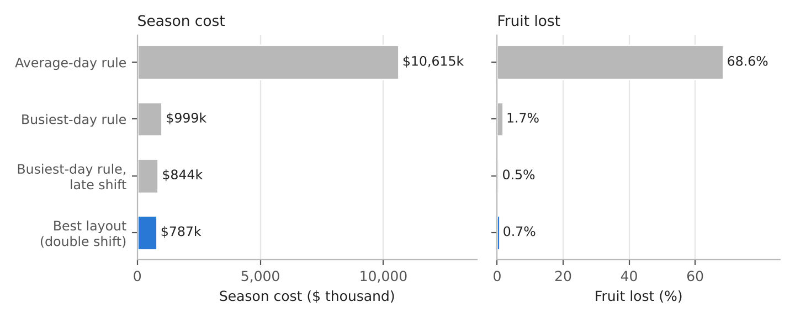
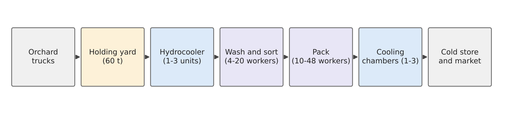
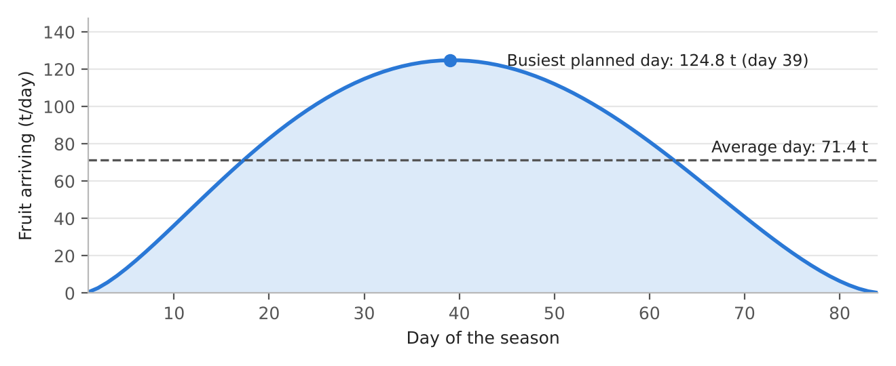
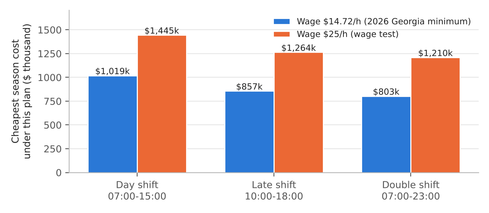
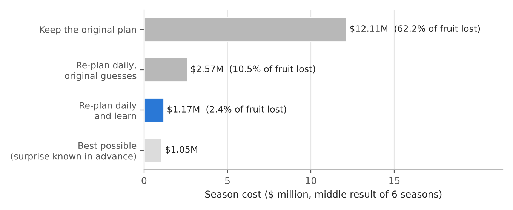
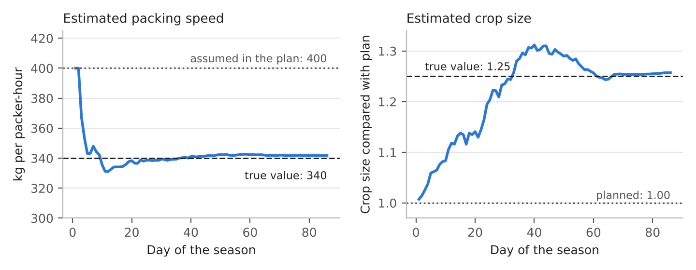
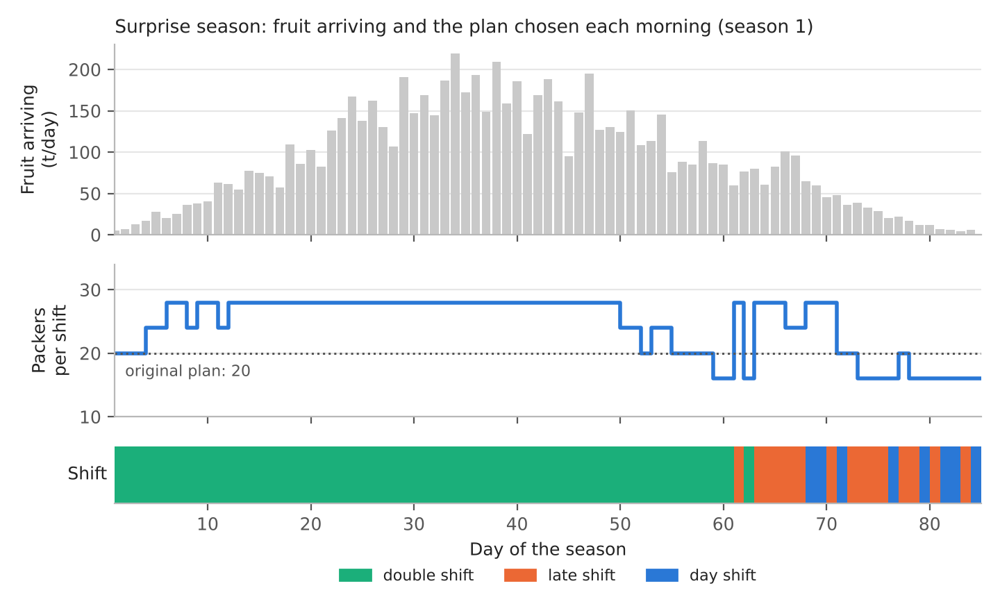

# Planning Crew Size and Working Hours in a Peach Packinghouse

**A simulation study with daily re-planning** · Python · 2026

Peaches spoil within a few days if they sit in the heat, so every hour a load waits before it is cooled costs money. This project builds a computer model of a medium-sized peach packinghouse in Georgia, USA, and uses it to answer a practical question: **how many machines and workers should it have, and which hours should they work?**

The model tried **4,860 different set-ups** and added up the cost of each one over a whole season: wages, equipment, energy, and the value of the fruit that spoiled.

**Main results**

- **Working hours matter more than headcount.** The cheapest set-up runs a fairly small crew (8 sorters, 20 packers) on a **double shift**. It costs about **$787,000 a season** and loses **0.7%** of the fruit.
- **Planning for an "average day" fails badly.** It costs **13.5 times** as much and loses **69%** of the fruit, because the busy weeks overwhelm it.
- **Timing is free.** Moving a crew to a shift that matches when the trucks arrive cuts its cost by **16%** without buying anything.
- **A higher wage does not change the answer.** At $25 an hour instead of $14.72, cost rises **52%** but the best set-up stays the same.
- **Re-planning every morning rescues a bad season.** With 25% more fruit and slower packers than planned, the original plan costs **$12.1 million**. Re-planning each morning from the packinghouse's own records brings it down to **$1.2 million**.



The full write-up is in [`report/`](report) (PDF and Word). This README covers the whole project on its own.

---

## Contents

1. [The problem](#1-the-problem)
2. [The packinghouse](#2-the-packinghouse)
3. [Data: sourced and assumed](#3-data-sourced-and-assumed)
4. [How the model works](#4-how-the-model-works)
5. [What was tested](#5-what-was-tested)
6. [Results](#6-results)
7. [Checking the main number by hand](#7-checking-the-main-number-by-hand)
8. [What it means](#8-what-it-means)
9. [Limitations](#9-limitations)
10. [Is this a digital twin?](#10-is-this-a-digital-twin)
11. [Running the code](#11-running-the-code)
12. [Repository layout](#12-repository-layout)
13. [References](#13-references)

---

## 1. The problem

About **25%** of the world's fruit and vegetables is lost between harvest and the shop [1]. Peaches show why. At room temperature (19–20 °C) they last only **3 to 5 days**, but in cold storage they last **2 to 4 weeks** [2, 3]. So they are cooled quickly after harvest, usually with cold water (**hydrocooling**) and, once packed, with cold air [4].

A packinghouse is where this happens. Its owner has to decide how many machines to buy, how many workers to hire and which hours to work:

- **Too small, or working the wrong hours:** fruit waits in the heat and spoils.
- **Too big:** money is wasted on idle workers and machines.

A common shortcut is to plan for an average day. But harvests are not average: fruit comes in waves, with a few very busy weeks in the middle. Labour is also expensive. Many US packinghouses rely on seasonal workers on H-2A visas (398,258 positions approved in 2025 [5]), whose minimum wage in Georgia is **$14.72 an hour in 2026** [6].

The study asks five questions:

1. What is the cheapest set-up of machines, workers and shift hours for a whole season?
2. How do two common shortcuts compare: planning for the average day, and planning for the busiest day?
3. How much does the timing of the shifts matter?
4. What happens if the wage rises to $25 an hour?
5. If the season turns out worse than planned, does re-planning every morning from the packinghouse's own records help?

## 2. The packinghouse



- **Arrivals:** trucks bring bins of peaches between 07:00 and 17:00.
- **Holding yard:** fruit waits here (up to 60 t) until it can be processed. If the yard is full, arriving trucks are turned away and their fruit is lost.
- **Four steps:**
  1. **Hydrocooling:** a cold-water shower on a conveyor.
  2. **Washing and sorting:** workers pick out damaged fruit.
  3. **Packing:** workers fill 25-lb boxes.
  4. **Forced-air cooling chambers:** cold air is drawn through the packed boxes.
- **Hours:** hydrocooling, sorting and packing work **only during shift hours**. The cooling chambers run **day and night**.

The numbers in brackets in the figure are the choices the model is allowed to make.

## 3. Data: sourced and assumed

**Sourced.** These numbers come from published sources:

| Item | Value | Source |
|---|---|---|
| Shelf life at room temperature | 3 to 5 days (19–20 °C) | [2, 3] |
| Shelf life in cold storage | 2 to 4 weeks | [2, 3] |
| Cooling practice | Hydrocooling; cool within 8 hours; rejected fruit sold mainly as cattle feed | [4] |
| Worker wage, Georgia, 2026 | $14.72 per hour (H-2A minimum) | [6] |
| Fruit loss worldwide (fruit and vegetables) | 25.4% | [1] |

**Assumed.** No public figure was found for these, so they were set by judgement. They are the weakest part of the study, which is why they are listed here and labelled `[A]` in [`perish/cases.py`](perish/cases.py). Any of them can be changed and re-tested (Section 11).

| Item | Value |
|---|---|
| Season | 84 days, 6,000 t, busiest around day 40, daily amount varies by about 20% |
| Trucks | 4 to 8 t each, arriving 07:00–17:00 after a 1-hour trip |
| Holding yard | 60 t |
| Speeds | Hydrocooler 12 t/h per unit; sorting 1,000 kg/h and packing 400 kg/h per worker |
| Cooling chamber | 2 truckloads per 3-hour cycle, runs 24 hours a day |
| Shift plans | Day 07:00–15:00; late 10:00–18:00; double 07:00–23:00 (two crews) |
| Pay extra | Late shift +5%; second shift +10% |
| Equipment and energy | $25,000 per hydrocooler and $30,000 per chamber per season; electricity $0.12/kWh |
| Fruit value | $2.43/kg packed ($1.10/lb); rejected fruit $0.05/kg (cattle feed) |
| Market requirement | 7 days in cold distribution plus 1 day on a shop shelf |

The planned harvest follows a smooth hump. The **busiest day is 75% above the average day**, and that gap is the heart of the problem:



## 4. How the model works

The model is a **discrete-event simulation**: it follows every truckload through every step and records when it arrives, when it starts and finishes each step, and how long it sat in the heat.

### 4.1 Building a season

- **Daily amount:** each day's tonnage = 6,000 t × that day's share of the harvest curve × a random factor (about ±20%).
- **Trucks:** truckloads of 4 to 8 t are added until the day's tonnage is reached. Each gets a random arrival time between 07:00 and 17:00, and its own **shelf-life budget** (Section 4.3).
- **Seeds:** a *seed* number fixes all the random draws, so season 1000 is exactly the same season on every computer. This is what makes the results reproducible to the dollar.

### 4.2 Moving fruit through the steps

- **Crew steps (sorting, packing):** these are first-come, first-served lines. Their speed is the number of workers × kg per worker-hour. For example, 20 packers × 400 kg/h = 8,000 kg/h, so a 6-tonne truck takes about 45 minutes.
- **Machines (hydrocoolers, chambers):** each load takes the first unit that becomes free.
- **Shift calendar:** work that isn't finished when a shift ends waits for the next shift. A truck arriving at 16:30 under the day shift (which ends at 15:00) waits until 07:00 the next morning.

### 4.3 Counting fruit quality: the shelf-life budget

Each truckload starts with a **shelf-life budget**: the number of hours it can spend at room temperature before it is too old to sell fresh. The average is **96 hours** (4 days), and it varies from load to load by about 12 hours.

- **Warm waiting:** every hour uses one hour of budget.
- **After hydrocooling:** the fruit is partly cooled, so an hour uses only **0.4 hours**.
- **In cold storage:** the budget is used **5 times more slowly** (about 3 weeks cold against about 4 days warm).

A load must leave with enough budget for the rest of its journey:

> 7 days cold (7 × 24 ÷ 5 = **33.6 h**) + 1 day on a shop shelf (**24 h**) = **57.6 hours**

So an average load can afford 96 − 57.6 = **38.4 hours** of warm waiting. Loads that leave with less are rejected and sold as cattle feed.

> **Example (rounded).** A truck arrives at 16:30, after the day shift has ended. It waits until 07:00 and is hydrocooled by 07:45: 1 h on the road + 15.25 h waiting = 16.25 h. It then waits until 11:00 for a chamber (3.25 h × 0.4 = 1.3 h), and cooling adds about 0.6 h. **Total: about 18 hours.**
> - An average load (96 h) leaves with 78 h and is **sold**.
> - A riper load (75 h) leaves with 57 h, just under 57.6, and is **rejected**.
>
> With the **double shift**, the same truck is hydrocooled as soon as it arrives and spends only about **3 hours** warm.

### 4.4 Counting cost

| Part | How it is counted |
|---|---|
| Wages | workers per shift × $117.76 (8 h × $14.72) × shift factor × days. Shift factor: day 1.00, late 1.05, double 2.10 |
| Equipment and energy | season charge per machine + the electricity it uses |
| Lost fruit | kg rejected or turned away × ($2.43 − $0.05) = kg × $2.38 |

## 5. What was tested

### 5.1 Every set-up

A **set-up** is one choice of:
- hydrocoolers (1–3),
- sorters (4–20),
- packers (10–48),
- cooling chambers (1–3),
- shift plan (day, late or double).

That makes **4,860 set-ups**. Each was run through 5 simulated seasons, and the **25 cheapest were re-run on 30 new seasons** to choose the winner. Every set-up faced the *same* seasons, so differences in cost come from the set-ups and not from luck [7].

### 5.2 Two shortcuts (rules of thumb)

- **Average-day rule:** give each step enough capacity for the average day (71.4 t) + 10%, in one 8-hour day shift.
- **Busiest-day rule:** the same, for the busiest planned day (124.8 t).

### 5.3 Wage test

The wage was raised from $14.72 to **$25 an hour** (+70%), reflecting workers' demands for higher pay, and the full search was repeated.

### 5.4 Surprise season and daily re-planning

A plan made before the season rests on guesses: how much fruit will come and how fast people will pack. To test what happens when the guesses are wrong, a **surprise season** was simulated:

- **25% more fruit:** 7,500 t instead of 6,000 t.
- **Packers 15% slower:** 340 kg/h instead of 400.

It was run **6 times** under each of three ways of operating:

1. **Keep the original plan:** the best set-up from 5.1, unchanged all season.
2. **Re-plan every morning, original guesses:** still believing 400 kg/h and 6,000 t.
3. **Re-plan every morning and learn from the records.**

The re-planning step works like this every morning ([`perish/twin.py`](perish/twin.py)):

1. **Read the records.** These are truck weights and arrival times, and when each load started and finished each step, up to that morning. A real packinghouse would get these from its scales and bin scans; here they come from the simulated season.
2. **Learn the real numbers.**
   - *Packing speed* = kg packed ÷ packer-hours worked.
   - *Crop size* = fruit received so far ÷ fruit the plan expected by now.
3. **Choose today's plan.** It tries 24 options (3 shift plans × 4 packer levels × 2 sorter levels). For each, it simulates the rest of the season starting from what is in the building now, then uses the cheapest. Machines can't be changed mid-season.

> **Example.** The records show 34,000 kg packed in 100 packer-hours, so the real speed is **340 kg/h**, not 400.
>
> For the crop: by day 20, 990 t have arrived when the plan expected 791 t, a raw ratio of 1.25. To avoid over-reacting to a few unusual days, 600 t (10% of the season) is added to both numbers: (990 + 600) ÷ (791 + 600) = **1.14**. As more fruit arrives, the estimate moves toward the true value of 1.25.

The results were compared with the **best possible**: the best set-up if the surprise had been known in advance, which was found by a full search of the surprise season.

## 6. Results

### 6.1 The best set-up against the shortcuts

| Set-up | Hydrocoolers / sorters / packers / chambers / shift | Wages | Equipment + energy | Lost fruit | **Season cost** | Fruit lost | Average warm time |
|---|---|---|---|---|---|---|---|
| Average-day rule | 1 / 10 / 26 / 1 / day | $357,378 | $63,497 | $10,193,688 | **$10,614,563** | 68.6% | 50.9 h |
| Busiest-day rule | 2 / 18 / 44 / 2 / day | $614,754 | $126,975 | $257,532 | **$999,261** | 1.7% | 8.9 h |
| Busiest-day rule, late shift | 2 / 18 / 44 / 2 / late | $644,214 | $126,941 | $72,912 | **$844,068** | 0.5% | 5.3 h |
| **Best set-up** | **1 / 8 / 20 / 2 / double** | $581,640 | $101,934 | $103,216 | **$786,791** | **0.7%** | **6.1 h** |

*Average of 30 simulated seasons. Worker numbers are per shift.*

At first it is surprising that the best set-up has **fewer workers per shift** than the average-day rule. The reason is hours:

- **Best set-up:** 20 packers × 400 kg/h × **16 h** = **128 t per day**.
- **Average-day rule:** 26 packers × 400 kg/h × **8 h** = **83 t per day**.

The busiest planned day brings 124.8 t, and random variation pushes busy days well above that. So the average-day packinghouse falls further behind every busy day: fruit waits 51 hours on average, 12% of it is turned away at a full yard, and 69% is lost in total. The busiest-day rule works, but it needs 62 workers per shift and still leaves fruit waiting overnight.

The best set-up costs about **$1.49 per 25-lb box**. Wages are **74%** of its cost.

### 6.2 Timing of the shifts



*Blue bars: the cheapest set-up under each shift plan from the 5-season search, which is why the double-shift bar ($803k) is slightly above the confirmed $787k.*

- **Day shift:** costs **27%** more than the double shift.
- **Late shift:** costs **7%** more, even with the same people, because it matches when the trucks arrive.
- **Free improvement:** moving the busiest-day crew from the day shift to the late shift cuts its cost by **16%** ($999k to $844k).
- **A narrow target:** only **10 of the 4,860** set-ups come within 5% of the best, so a set-up chosen by guesswork is unlikely to be close.

### 6.3 Wage test: $14.72 to $25 an hour

| | Wage $14.72/h | Wage $25/h |
|---|---|---|
| Best set-up | 1 / 8 / 20 / 2 / double | 1 / 8 / 20 / 2 / double (**unchanged**) |
| Best season cost | $786,791 | $1,192,990 |
| Cost per 25-lb box | $1.49 | $2.25 |
| Fruit lost | 0.7% | 0.7% |
| Average-day rule compared with best | 13.5× | 9.1× |
| Double shift's lead over late shift | 6.3% | 4.3% |

- **The best set-up did not change**, so a packinghouse could keep the same set-up even if wages rose a lot.
- **Cost rose 52%.** This fits with wages being 74% of the cost and rising 70% (0.74 × 0.70 = 0.52).
- **Each extra $1/hour adds about $39,500 a season**, about **7.5 cents per box**. A packinghouse could use this number to judge whether it can afford a wage demand.
- **The double shift's lead shrinks** because the second shift is paid extra. At a high enough wage the late shift would win; finding that break-even wage is a natural next test.

### 6.4 Surprise season: does re-planning help?



The original plan has no spare capacity, so a bigger crop and slower packers overwhelm it: **62% of the fruit is lost** and the season costs **$12.1 million**.

- **Re-planning with the old guesses** helps a great deal ($2.6M), but it keeps scheduling too few packers.
- **Re-planning while learning from the records** brings the cost down to **$1.17M** with 2.4% lost. That is:
  - **90%** below keeping the original plan;
  - **55%** below re-planning with the old guesses;
  - only **11%** above the best possible, which also had an extra hydrocooler.

All six seasons, in $ thousand / fruit lost:

| Season | Keep the original plan | Re-plan daily, original guesses | Re-plan daily and learn |
|---|---|---|---|
| 1 | 12,966 / 67.1% | 2,977 / 12.7% | 1,369 / 3.6% |
| 2 | 10,310 / 55.2% | 2,210 / 9.0% | 1,080 / 2.2% |
| 3 | 11,847 / 60.8% | 2,675 / 11.0% | 1,279 / 3.0% |
| 4 | 11,271 / 58.7% | 2,470 / 10.0% | 1,111 / 2.2% |
| 5 | 12,365 / 63.6% | 2,458 / 9.7% | 1,123 / 2.2% |
| 6 | 13,573 / 68.0% | 2,911 / 11.8% | 1,218 / 2.6% |
| **Middle result** | **12,106 / 62.2%** | **2,572 / 10.5%** | **1,171 / 2.4%** |

### 6.5 How fast it learns



- **Packing speed:** across the six seasons, the estimate was within 3% of the true 340 kg/h by **day 3 to 14**.
- **Crop size:** the estimate first came within 5% of the true 1.25 by **day 15 to 24**. It climbs gradually because the 600 t cushion stops it over-reacting early.
- **Overshoot:** in the season shown, the crop estimate overshoots to about 1.3 during the busiest weeks. Unusually heavy days count fully, and the estimate settles once the season's shape becomes clear.

### 6.6 What it decided each day



- **Busy weeks:** the loop quickly raises packers from the planned 20 to 28 per shift and keeps the double shift.
- **Tail of the season:** as arrivals fall, it cuts back to fewer packers and shorter shifts (late or day).

## 7. Checking the main number by hand

| Part | Calculation | Result |
|---|---|---|
| Wages | 28 workers (8 + 20) × $117.76 × 2.10 × 84 days | $581,640 |
| Hydrocooler | $25,000 + 30 kW × 16 h × 84 days × $0.12 | $29,838 |
| Two cooling chambers | 2 × ($30,000 + 25 kW × 24 h × 84 days × $0.12) | $72,096 |
| Lost fruit | 43,368 kg (0.7% of the fruit) × $2.38 | $103,216 |
| **Total** | | **$786,790** (model: $786,791) |

**More checks:**
- **Capacity:** 20 × 400 × 16 = 128 t/day against 26 × 400 × 8 = 83 t/day.
- **Wage test:** $581,640 ÷ $14.72 = **39,514 paid hours** in the season. That is the cost of a $1/hour raise, because the set-up didn't change.
- **Agreement with practice:** post-harvest guidance says to cool susceptible peaches within 8 hours [4]. The model was never told this rule, yet its best set-up keeps fruit warm for only 6.1 hours on average. This is reassuring, though it doesn't prove the model right.

## 8. What it means

1. **When people work matters as much as how many people work.** A smaller crew on two shifts beat a larger crew on one.
2. **Average-day planning hides the busy days**, and the busy days are what cause the losses.
3. **The plan that is cheapest on paper has little spare capacity.** Re-planning from the packinghouse's own records is a low-cost way to protect it against surprises.
4. **Wage rises change the bill, not the logic of the design.**

## 9. Limitations

- **Not a real facility.** The packinghouse is typical, not a real company. Many inputs are assumptions (Section 3), so the dollar amounts are rough. The comparisons between set-ups are more trustworthy than the exact amounts.
- **Simple quality model.** Fruit quality is a shelf-life budget only. It ignores varieties, bruising and cold damage, and it is more lenient than the 8-hour guideline, so real losses from delays are probably higher.
- **Simulated records only.** The re-planning step was tested only on simulated records with two deliberate surprises. Real records have gaps, mistakes and delays.
- **Partial costs.** Costs cover workers, cooling equipment, energy and lost fruit, not cartons, buildings or management. The double shift needs two crews, and the difficulty of hiring them is not modelled.

## 10. Is this a digital twin?

**No, not yet.** Kritzinger et al. [8] describe three levels:

| Level | Meaning | This project |
|---|---|---|
| Digital model | A model with no automatic link to a real facility | **This is what it is** |
| Digital shadow | Live data from the facility flows *into* the model | What it would become if fed real scale and bin-scan records |
| Digital twin | Data flows both ways: the model's decisions are used to run the facility | What it would become if its daily plans were actually used |

The re-planning step (read records → learn → re-plan) is the kind of loop a digital twin would use, so the model is a starting point for one. A real deployment would still need data collection, checking against real records, and a manager approving the plans.

## 11. Running the code

Requires Python 3.10 or newer.

```bash
pip install -r requirements.txt
export PYTHONPATH=.            # Windows PowerShell: $env:PYTHONPATH="."

python scripts/01_ground_truth.py                    # all 4,860 set-ups, planned + surprise season (~15-20 min)
python scripts/02_twin_demo.py                       # surprise season, 3 ways x 6 seasons (~7 min)
python scripts/05_sensitivity.py wage_per_hour 25    # wage test (~12 min)
python scripts/03_analyse.py                         # summary + all figures (seconds)
```

**Expected output.** The seeds are fixed, so a correct run reproduces the numbers exactly:
- **Script 01:** best set-up `{'n_hyd': 1, 'n_sort': 8, 'n_pack': 20, 'n_fac': 2, 'shift_plan': 3}` at **786791**, and the surprise-season best at **1052103**.
- **Script 02:** the 18 seasons in the table in Section 6.4.
- **Script 05:** **$1,192,990** at $25/h.

**Testing other assumptions.** `python scripts/05_sensitivity.py --list` shows every assumption that can be changed: wage, yard size, packing or sorting speed, hydrocooler speed, fruit price, shelf life, season volume, haul time, electricity price and the cold slow-down factor. Change one with `python scripts/05_sensitivity.py <name> <value>`. Your baseline results are never overwritten.

## 12. Repository layout

```
perish/
  engine.py        the simulator: seasons, shift calendars, queues, machines, yard, quality, cost
  cases.py         every input for the peach packinghouse, labelled [S] sourced or [A] assumed
  design.py        the rule-of-thumb sizing
  scenarios.py     the surprise season
  twin.py          the daily read-records -> learn -> re-plan loop
scripts/
  01_ground_truth.py    search all set-ups (planned and surprise seasons)
  02_twin_demo.py       run the surprise season three ways
  03_analyse.py         summary numbers and the figures in this README
  05_sensitivity.py     change one assumption and repeat the search
results/           outputs of the scripts (CSV, JSON)
figures/           the figures in this README
report/            full project report (PDF and Word)
```

## 13. References

1. FAO (2025). *International Day of Awareness of Food Loss and Waste.* Food and Agriculture Organization of the United Nations. fao.org
2. University of Georgia Extension. *Bulletin B1555: Peaches, Appropriate Harvest and Postharvest Handling.* fieldreport.caes.uga.edu
3. UC Davis Postharvest Center. *Produce Facts: Peach and Nectarine.* postharvest.ucdavis.edu
4. Crisosto, C.H. and Valero, D. (2008). Harvesting and postharvest handling of peaches for the fresh market. In: *The Peach: Botany, Production and Uses.* CAB International.
5. American Farm Bureau Federation. *Market Intel: H-2A program use continues to soar.* fb.org
6. Specialty Crop Grower (2026). *New AEWRs announced for southeastern states.* specialtycropgrower.com
7. Law, A.M. (2015). *Simulation Modeling and Analysis,* 5th edition. McGraw-Hill.
8. Kritzinger, W., Karner, M., Traar, G., Henjes, J. and Sihn, W. (2018). Digital twin in manufacturing: a categorical literature review and classification. *IFAC-PapersOnLine,* 51(11), 1016–1022.

*Author: Zahin Tasnim Ridita. The packinghouse is a representative case, not a specific company.*
